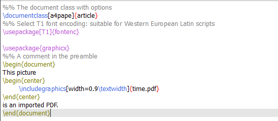
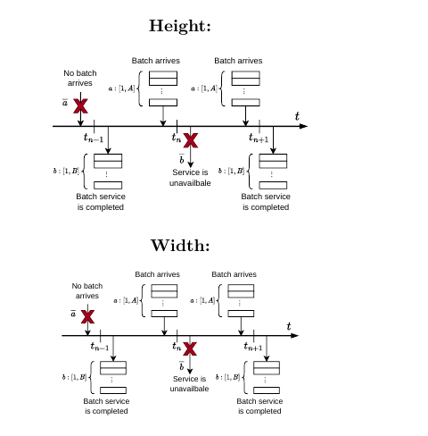

---
## Front matter
lang: ru-RU
title: Лабораторная работа №4
author:
  - Морозова Ульяна
institute:
  - Российский университет дружбы народов, Москва, Россия

date: 22 october 2026

## i18n babel
babel-lang: russian
babel-otherlangs: english

## Formatting pdf
toc: false
toc-title: Содержание
slide_level: 2
aspectratio: 169
section-titles: true
theme: metropolis
header-includes:
- \metroset{progressbar=frametitle,sectionpage=progressbar,numbering=fraction}
---

## **Цель работы**

Ознакомиться с методами включения графики в документы LaTeX, настройкой плавающих объектов, позиционированием изображений и механизмом перекрестных ссылок.

## Подключение графики

Для включения графики используется пакет `graphicx`, который добавляет команду `\includegraphics` для вставки изображений.

{ #fig:001 width=50% }
{ #fig:002 width=50% }

## Параметры изображений

С помощью квадратных скобок можно задавать параметры: `width` и `height` (размеры), `angle` (поворот) и `scale` (масштабирование).

{ #fig:003 width=50% }
{ #fig:004 width=50% }

## Ширина: `\textwidth` и `\linewidth`

`\textwidth` — ширина всего текстового блока. `\linewidth` — ширина текущей строки (важно при использовании двух колонок `twocolumn`).

{ #fig:005 width=50% }
{ #fig:006 width=50% }

## Плавающие объекты

Окружение `figure` и спецификаторы `[htbp]` (here, top, bottom, page) позволяют LaTeX автоматически размещать изображения, чтобы избежать больших пустых пробелов.

{ #fig:007 width=50% }
{ #fig:008 width=50% }

## Перекрестные ссылки

Для ссылок используются `\label{...}` и `\ref{...}`. Для корректного отображения номеров требуется **минимум два прогона** компилятора (для записи меток в файл `.aux`).

{ #fig:009 width=50% }

## Типичные ошибки при `\label`

`\label` всегда привязывается к последнему нумерованному объекту. Если разместить её *до* `\caption` или *после* `\end{equation}`, ссылка укажет на номер раздела, а не на рисунок/формулу.

{ #fig:011 width=50% }
{ #fig:012 width=50% }

## Выводы

Мы научились подключать графические файлы в LaTeX, управлять их размерами и ориентацией, а также освоили работу с плавающими объектами и перекрестными ссылками. Были выявлены типичные ошибки при размещении меток `\label`.

::: {#refs}
:::