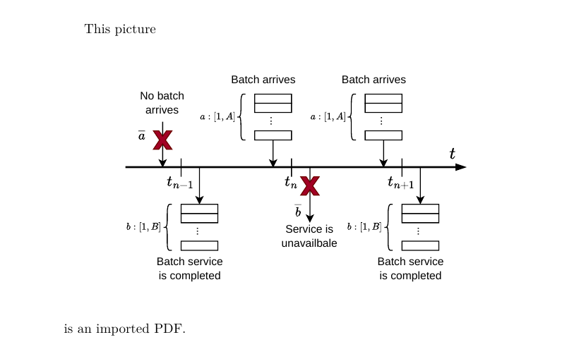
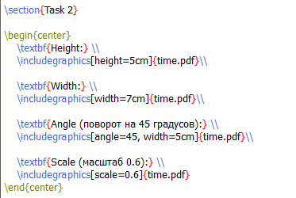
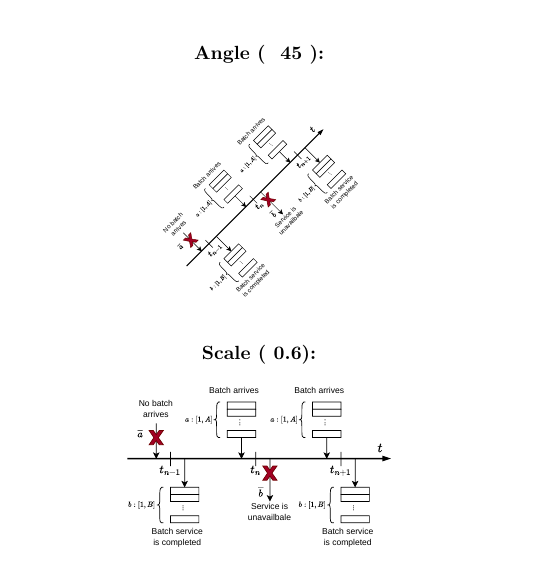
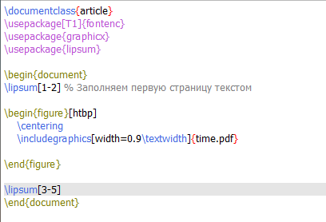
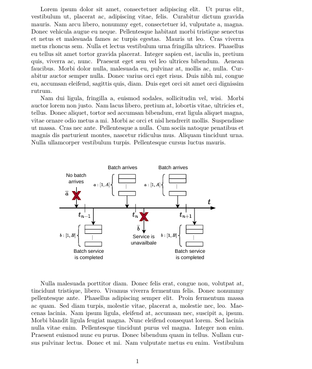
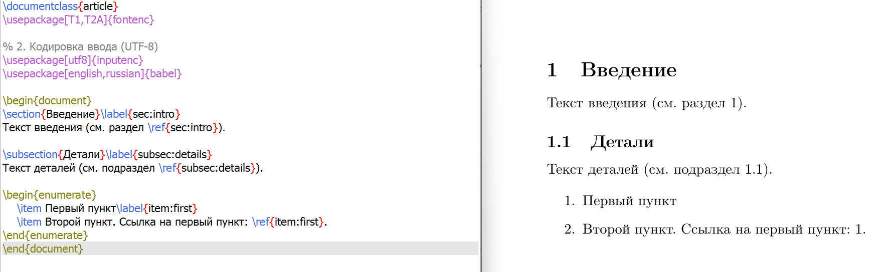

---
## Front matter
title: "Отчет по лабораторной работе №4"
subtitle: "*дисциплина: Computer Skills for Scientific Writing*"
author: "Морозова Ульяна"

## Generic otions
lang: ru-RU
toc-title: "Содержание"
reference-section-title: "Список литературы"

## Bibliography
bibliography: bib/cite.bib
csl: pandoc/csl/gost-r-7-0-5-2008-numeric.csl

## Pdf output format
toc: true # Table of contents
toc-depth: 2
lof: false # List of figures
lot: false # List of tables
fontsize: 12pt
linestretch: 1.5
papersize: a4
documentclass: scrreprt
## I18n polyglossia
polyglossia-lang:
  name: russian
  options:
	- spelling=modern
	- babelshorthands=true
polyglossia-otherlangs:
  name: english
## I18n babel
babel-lang: russian
babel-otherlangs: english
## Fonts
mainfont: IBM Plex Serif
romanfont: IBM Plex Serif
sansfont: IBM Plex Sans
monofont: IBM Plex Mono
mathfont: STIX Two Math
mainfontoptions: Ligatures=Common,Ligatures=TeX,Scale=0.94
romanfontoptions: Ligatures=Common,Ligatures=TeX,Scale=0.94
sansfontoptions: Ligatures=Common,Ligatures=TeX,Scale=MatchLowercase,Scale=0.94
monofontoptions: Scale=MatchLowercase,Scale=0.94,FakeStretch=0.9
mathfontoptions:
## Biblatex

biblio-style: "gost-numeric"
biblatexoptions:
  - parentracker=true
  - backend=biber
  - hyperref=auto
  - language=auto
  - autolang=other*
  - citestyle=gost-numeric
## Pandoc-crossref LaTeX customization
figureTitle: "Рис."
tableTitle: "Таблица"
listingTitle: "Листинг"
lofTitle: "Список иллюстраций"
lotTitle: "Список таблиц"
lolTitle: "Листинги"
## Misc options
indent: true
header-includes:
  - \usepackage{indentfirst}
  - \usepackage{float} # keep figures where there are in the text
  - \floatplacement{figure}{H} # keep figures where there are in the text
---

# **Цель работы**

Ознакомиться с методами включения графики в документы LaTeX, настройкой плавающих объектов, позиционированием изображений и механизмом перекрестных ссылок.

# Выполнение лабораторной работы

Для начала работы над графикой в преамбуле документа необходимо подключить пакет `graphicx`, который добавляет команду `\includegraphics` для вставки изображений [@graphicx].

**1. Включение собственного изображения**

Для вставки изображения мы используем команду `\includegraphics`. Если необходимо центрировать изображение по горизонтали, его помещают в окружение `center`. 

{ #fig:001 width=70% }

{ #fig:002 width=70% }

**2. Изменение внешнего вида (параметры height, width, angle, scale)**

С помощью квадратных скобок можно задавать параметры изображения. `width` и `height` задают размеры (часто в относительных единицах, например `0.5\textwidth`), `angle` поворачивает картинку, а `scale` масштабирует ее на заданный коэффициент, сохраняя пропорции.

{ #fig:003 width=70% }

{ #fig:004 width=70% }

{ #fig:004 width=70% }

**3. Разница между `\textwidth` и `\linewidth`**

Ширина `\textwidth` — это ширина всего текстового блока на странице, а `\linewidth` — ширина текущей строки. В одноколоночном документе они равны, но при использовании опции `twocolumn` в классе документа `\linewidth` становится равен ширине одной колонки, что важно учитывать при вставке картинок, чтобы они не выходили за поля.

{ #fig:005 width=70% }

{ #fig:006 width=70% }

**4. Плавающие объекты и параметры их размещения**

Для того чтобы изображения не оставляли больших пустых пробелов на странице, их помещают в плавающие окружения `figure` (floats). Спецификаторы в квадратных скобках `[htbp]` указывают LaTeX, куда можно поместить объект: `h` (here — здесь), `t` (top — вверху), `b` (bottom — внизу), `p` (page — на отдельной странице). Для демонстрации был использован пакет `lipsum`, генерирующий текст-заполнитель [@lipsum].

{ #fig:007 width=70% }

{ #fig:008 width=70% }

**5. Перекрестные ссылки и количество компиляций**

Для создания ссылок используются команды `\label{...}` и `\ref{...}`. При первом запуске компиляции LaTeX записывает метки в вспомогательный файл `.aux`, поэтому для корректного отображения номеров требуется **минимум два прогона** компилятора. Если ссылка не обновилась, может потребоваться третий запуск.

{ #fig:009 width=70% }

**6. Ошибка: `\label` перед `\caption`**

Команда `\label` всегда привязывается к последнему нумерованному объекту (разделу, уравнению, рисунку). Если разместить `\label` *до* команды `\caption`, LaTeX привяжет метку к предыдущему разделу, и в тексте ссылка будет указывать на номер раздела, а не на рисунок. 

{ #fig:011 width=70% }

**7. Ошибка: `\label` после `\end{equation}`**

Аналогичная ситуация происходит с формулами. Если `\label` находится после `\end{equation}`, метка привязывается к текущему разделу, а не к уравнению. Чтобы ссылка вела на формулу, `\label` должна находиться строго внутри окружения `equation`.

{ #fig:012 width=70% }

# Выводы

В ходе выполнения работы мы научились подключать графические файлы в LaTeX, управлять их размерами и ориентацией, а также освоили работу с плавающими объектами и перекрестными ссылками. Были выявлены типичные ошибки при размещении меток `\label` и понята необходимость многократной компиляции для корректной работы ссылок.

# Список литературы

::: {#refs}
:::