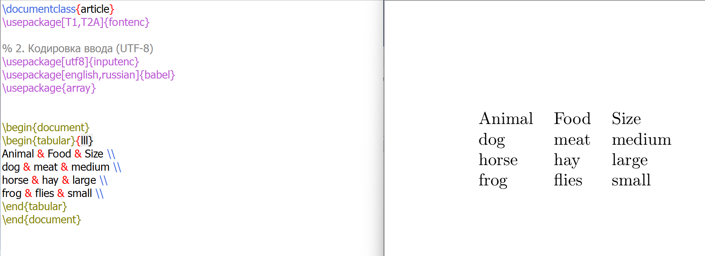
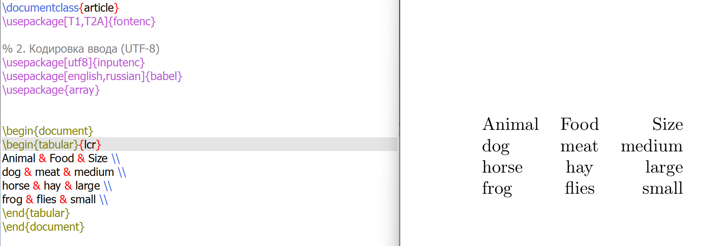
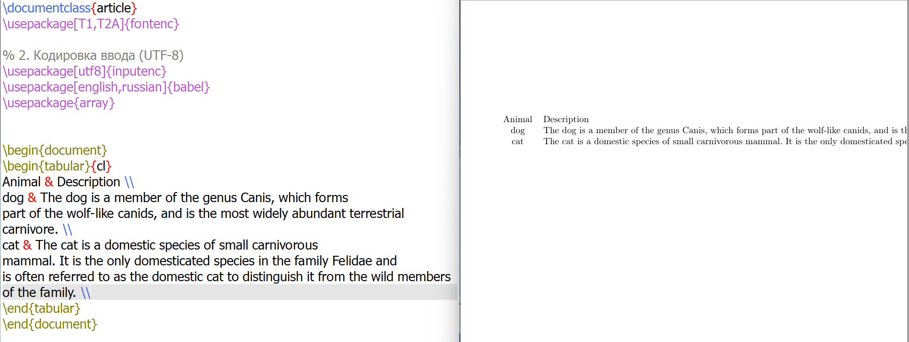
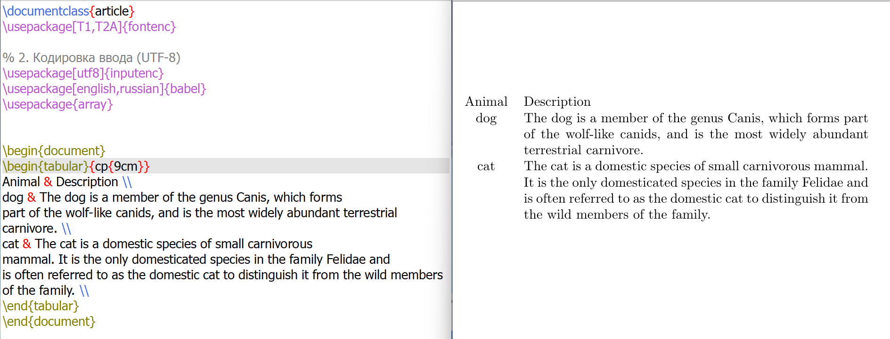
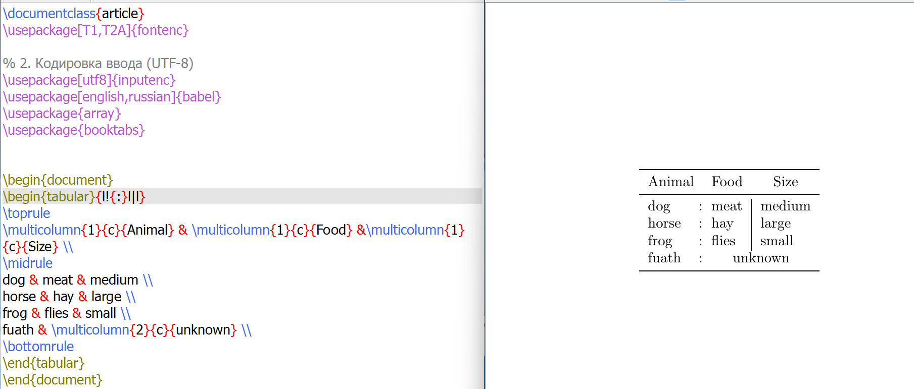

---
## Front matter
lang: ru-RU
title: Лабораторная работа №5
author:
  - Морозова Ульяна
institute:
  - Российский университет дружбы народов, Москва, Россия

date: 22 october 2026

## i18n babel
babel-lang: russian
babel-otherlangs: english

## Formatting pdf
toc: false
toc-title: Содержание
slide_level: 2
aspectratio: 169
section-titles: true
theme: metropolis
header-includes:
- \metroset{progressbar=frametitle,sectionpage=progressbar,numbering=fraction}
---

## **Цель работы**

Ознакомиться с методами форматирования таблиц в LaTeX [@practical_scientific_writing].

## Базовая структура таблицы и выравнивание столбцов 1/2

В первом задании мы задали одинаковое выравнивание всех трех колонок по левому краю (`lll`).

{ #fig:001 width=75% }

## Базовая структура таблицы и выравнивание столбцов 2/2

Далее проверили работы смешанного выравнивания колонок `lcr` (первая колонка выровнена влево, вторая по центру, третья по правому краю), что наглядно видно по смещению элементов данных относительно заголовков.

{ #fig:002 width=75% }

## Обработка длинного текста 1/2

{ #fig:003 width=75% }

## Обработка длинного текста 2/2

{ #fig:004 width=75% }

## Профессиональные горизонтальные линии (booktabs) и объединение столбцов (`\multicolumn`)

{ #fig:005 width=75% }

## Настройка разделителей столбцов и вертикальные линии (`!{...}` и `|`)

{ #fig:006 width=75% }

## Избыток и недостаток элементов в строке

Если строка содержит меньше амперсандов `&`, чем объявлено столбцов в преамбуле таблицы, LaTeX оставляет недостающие правые ячейки пустыми, не прерывая компиляцию ошибкой.
Появление же лишнего символа `&` приводит к фатальной ошибке компилятора вида `! Extra alignment tab has been changed to \cr`, так как LaTeX встречает больше ячеек, чем объявлено в спецификаторе окружения.

## Выводы

В процессе выполнения упражнений 5 главы были освоены базовые и расширенные возможности верстки таблиц в LaTeX. 

::: {#refs}
:::