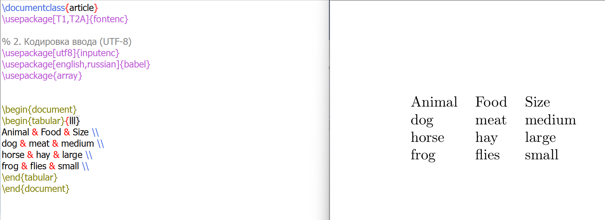
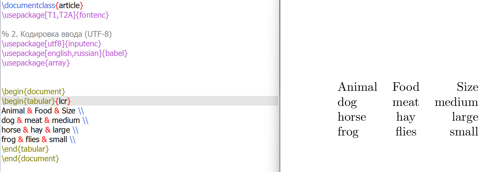
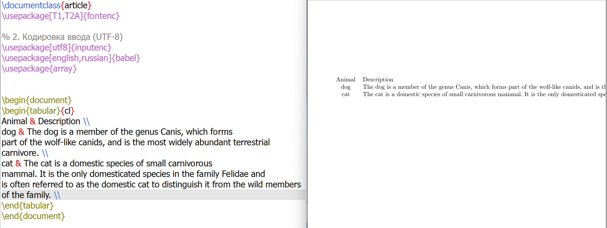
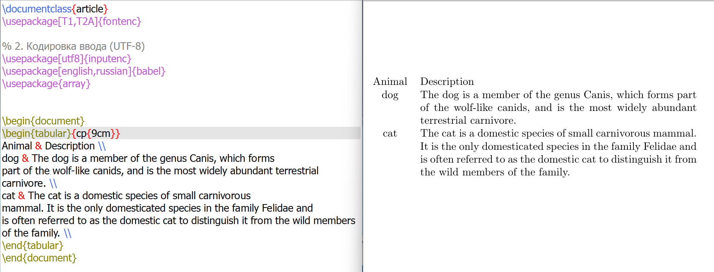
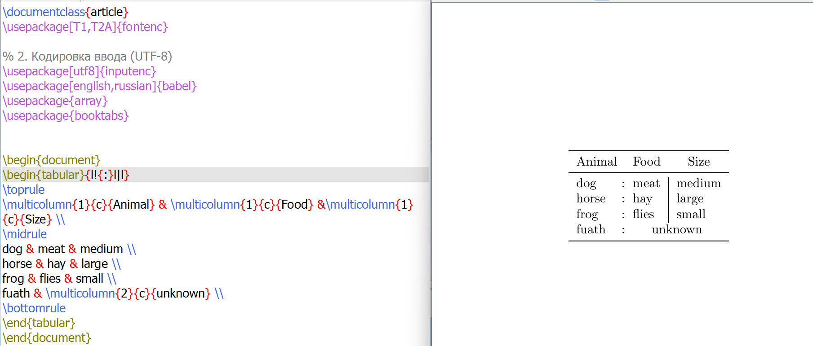

---
## Front matter
title: "Отчет по лабораторной работе №5"
subtitle: "*дисциплина: Computer Skills for Scientific Writing*"
author: "Морозова Ульяна"

## Generic otions
lang: ru-RU
toc-title: "Содержание"
reference-section-title: "Список литературы"

## Bibliography
bibliography: bib/cite.bib
csl: pandoc/csl/gost-r-7-0-5-2008-numeric.csl

## Pdf output format
toc: true # Table of contents
toc-depth: 2
lof: false # List of figures
lot: false # List of tables
fontsize: 12pt
linestretch: 1.5
papersize: a4
documentclass: scrreprt
## I18n polyglossia
polyglossia-lang:
  name: russian
  options:
	- spelling=modern
	- babelshorthands=true
polyglossia-otherlangs:
  name: english
## I18n babel
babel-lang: russian
babel-otherlangs: english
## Fonts
mainfont: IBM Plex Serif
romanfont: IBM Plex Serif
sansfont: IBM Plex Sans
monofont: IBM Plex Mono
mathfont: STIX Two Math
mainfontoptions: Ligatures=Common,Ligatures=TeX,Scale=0.94
romanfontoptions: Ligatures=Common,Ligatures=TeX,Scale=0.94
sansfontoptions: Ligatures=Common,Ligatures=TeX,Scale=MatchLowercase,Scale=0.94
monofontoptions: Scale=MatchLowercase,Scale=0.94,FakeStretch=0.9
mathfontoptions:
## Biblatex

biblio-style: "gost-numeric"
biblatexoptions:
  - parentracker=true
  - backend=biber
  - hyperref=auto
  - language=auto
  - autolang=other*
  - citestyle=gost-numeric
## Pandoc-crossref LaTeX customization
figureTitle: "Рис."
tableTitle: "Таблица"
listingTitle: "Листинг"
lofTitle: "Список иллюстраций"
lotTitle: "Список таблиц"
lolTitle: "Листинги"
## Misc options
indent: true
header-includes:
  - \usepackage{indentfirst}
  - \usepackage{float} # keep figures where there are in the text
  - \floatplacement{figure}{H} # keep figures where there are in the text
---

# **Цель работы**

Ознакомиться с методами форматирования таблиц в LaTeX.

# Выполнение лабораторной работы

Для работы с расширенным функционалом таблиц нужно подключить пакеты `array` и `booktabs`.

**1. Базовая структура таблицы и выравнивание столбцов (l, c, r)**

Для создания таблиц в LaTeX используется окружение `tabular` [@practical_scientific_writing]. В обязательных аргументах задаются спецификаторы выравнивания содержимого столбцов: `l` — по левому краю, `c` — по центру, `r` — по правому краю. Разделение столбцов выполняется символом `&`, а завершение строки — командой `\\`. 

В первом задании мы задали одинаковое выравнивание всех трех колонок по левому краю (`lll`).

{ #fig:001 width=75% }

Далее проверили работы смешанного выравнивания колонок `lcr` (первая колонка выровнена влево, вторая по центру, третья по правому краю), что наглядно видно по смещению элементов данных относительно заголовков.

{ #fig:002 width=75% }

**2. Обработка длинного текста: сравнение спецификаторов `l` и `p{width}`**

Стандартные столбцы типа `l`, `c` и `r` подстраиваются под естественную ширину самой длинной строки без автоматического переноса, из-за чего длинный абзацный текст выходит за границы страницы.

{ #fig:003 width=75% }

Для решения этой проблемы мы применили тип столбца `p{width}` (например, `p{9cm}`). Он форматирует содержимое как абзац фиксированной ширины с автоматическим переносом строк и выравниванием по ширине, предотвращая переполнение страницы.

{ #fig:004 width=75% }

**3. Профессиональные горизонтальные линии (booktabs) и объединение столбцов (`\multicolumn`)**

Для визуально строгого оформления таблиц мы использовали горизонтальные разделители из пакета `booktabs`: `\toprule` (верхняя линия), `\midrule` (разделитель под заголовком) и `\bottomrule` (нижняя линия).

Команда `\multicolumn{n}{alignment}{content}` позволяет:
1. Изменить выравнивание отдельной ячейки без смены формата всего столбца (например, выравнивание заголовков по центру `\multicolumn{1}{c}{...}` в столбцах с типом `l`).
2. Объединить несколько соседних столбцов в один (в строке `fuath` две колонки объединены конструкцией `\multicolumn{2}{c}{unknown}`).

{ #fig:005 width=75% }

**4. Настройка разделителей столбцов и вертикальные линии (`!{...}` и `|`)**

LaTeX позволяет кастомизировать интервал между колонками с помощью `!{decl}`(вставка произвольного символа или разделителя в центр пространства между колонками), а также задавать вертикальные линии символом `|`. 

Мы протестировали следующую команду `\begin{tabular}{!{:}l|l}`:
- Конструкция `!{:}` вставила двоеточие в качестве префикса/разделителя.
- Символ `|` добавил вертикальную черту между вторым и третьим столбцами таблицы.

{ #fig:006 width=75% }

**5. Избыток и недостаток элементов в строке**

Если строка содержит меньше амперсандов `&`, чем объявлено столбцов в преамбуле таблицы, LaTeX оставляет недостающие правые ячейки пустыми, не прерывая компиляцию ошибкой.
Появление же лишнего символа `&` приводит к фатальной ошибке компилятора вида `! Extra alignment tab has been changed to \cr`, так как LaTeX встречает больше ячеек, чем объявлено в спецификаторе окружения.

# Выводы

В процессе выполнения упражнений 5 главы были освоены базовые и расширенные возможности верстки таблиц в LaTeX. 

# Список литературы

::: {#refs}
:::